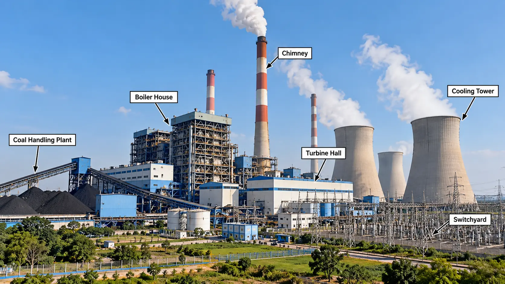

# Thermal Power Plant

  

## Introduction

A Thermal Power Plant is an electrical generating station in which the heat energy obtained from burning fuel is converted into electrical energy.

Coal is commonly used as fuel in conventional thermal power plants. The heat produced by burning coal converts water into high-pressure steam. This steam drives a turbine connected to an alternator, which generates electrical energy.

## Working Principle

A thermal power plant works on the principle of converting heat energy into mechanical energy and then into electrical energy.

The energy conversion takes place in the following sequence:

Chemical Energy of Coal
↓
Heat Energy
↓
Thermal Energy of Steam
↓
Mechanical Energy of Turbine
↓
Electrical Energy of Alternator

## Layout of a Thermal Power Plant

  

## Working of a Thermal Power Plant

1. Coal Handling: Coal is transported, crushed and pulverised before being supplied to the furnace.

2. Combustion: Pulverised coal is burnt in the furnace to produce heat.

3. Steam Generation: The boiler uses this heat to convert feedwater into high-pressure steam.

4. Steam Turbine: High-pressure steam expands through the turbine and rotates its blades.

5. Electricity Generation: The turbine drives an alternator, which converts mechanical energy into electrical energy.

6. Condensation: Exhaust steam from the turbine enters the condenser and is converted back into water.

7. Feedwater Circulation: The feedwater pump sends the water back to the boiler for reuse.

8. Flue Gas Exhaust: Flue gases pass through heat-recovery equipment before leaving through the chimney.

## Main Components of a Thermal Power Plant

### 1. Coal Handling Plant

It receives, stores, transports and prepares coal for combustion.

### 2. Boiler

The boiler converts feedwater into high-pressure steam using heat produced by burning fuel.

### 3. Furnace

The furnace is the chamber where coal is burnt to release heat energy.

### 4. Steam Turbine

The steam turbine converts the energy of high-pressure steam into mechanical rotational energy.

### 5. Alternator

The alternator converts the mechanical energy supplied by the turbine into electrical energy.

### 6. Condenser

The condenser converts exhaust steam from the turbine into water by removing heat.

### 7. Feedwater Pump

The feedwater pump supplies water to the boiler at the required pressure.

### 8. Cooling Tower

The cooling tower removes heat from circulating cooling water so that it can be reused.

### 9. Chimney

The chimney releases treated flue gases into the atmosphere at a suitable height.

### 10. Economiser

The economiser uses heat from flue gases to preheat the feedwater before it enters the boiler.

### 11. Air Preheater

The air preheater uses waste heat from flue gases to warm the air supplied to the furnace.

### 12. Ash Handling Plant

The ash handling plant collects and transports ash produced during coal combustion.

## Types of Thermal Power Plants

Thermal power plants can be classified according to the fuel and technology used.

- Coal-fired power plants
- Oil-fired power plants
- Natural gas-fired power plants
- Biomass-fired power plants
- Combined-cycle power plants

## Advantages of Thermal Power Plants

- Suitable for large-scale electricity generation.
- Can provide continuous power when fuel and water are available.
- Fuel can be stored for future use.
- Can be established near fuel sources to reduce transportation costs.
- Can supply electricity to industrial and domestic consumers.

## Disadvantages of Thermal Power Plants

- Conventional fossil-fuel plants produce greenhouse gas emissions.
- Fuel and water are required for regular operation.
- Fuel, maintenance and operating costs can be high.
- Coal-fired plants produce ash that requires proper handling.
- Starting a conventional steam power plant can take considerable time.

## Applications

- Generation of electricity for domestic use.
- Supply of electrical power to industries.
- Supply of electricity to commercial establishments.
- Feeding electricity into the national and regional power grids.

## Conclusion

A thermal power plant is an important source of electrical energy. It uses heat from fuel combustion to produce steam, which drives a turbine connected to an alternator. The alternator converts mechanical energy into electrical energy for domestic, commercial and industrial use.

## Important Questions

1. Define a thermal power plant.
2. Explain the working principle of a thermal power plant.
3. Draw and explain the layout of a thermal power plant.
4. Describe the functions of the main components of a thermal power plant.
5. Explain the working of a boiler, steam turbine and condenser.
6. State the advantages and disadvantages of a thermal power plant.
7. Explain the energy conversion process in a thermal power plant.
8. What are the functions of an economiser and an air preheater?
9. Explain the importance of the coal handling and ash handling plants.
10. Why is a condenser used in a thermal power plant?