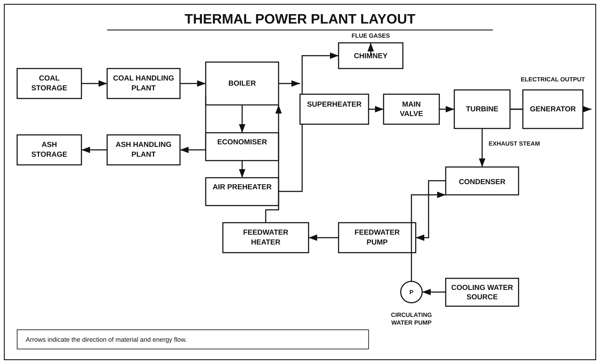

# Thermal Power Plant

## Introduction

A thermal power plant is a generating station in which heat energy is converted into electrical energy. Coal is commonly used as fuel in conventional thermal power plants.

The chemical energy of fuel is converted into heat energy, heat energy is converted into mechanical energy, and mechanical energy is converted into electrical energy.

## Layout of a Thermal Power Plant

## Working Principle

A thermal power plant works on the principle of converting heat energy into electrical energy.

1. Coal is supplied to the furnace after crushing and pulverising.
2. The coal is burnt in the furnace to produce heat.
3. The heat converts boiler water into high-pressure steam.
4. The steam drives the steam turbine.
5. The turbine rotates the alternator to generate electricity.
6. Exhaust steam enters the condenser and is converted into water.
7. The water is pumped back to the boiler for reuse.

## Main Components

### 1. Boiler

The boiler converts water into high-pressure steam using heat produced by fuel combustion.

### 2. Furnace

The furnace is the chamber where fuel is burnt to produce heat.

### 3. Steam Turbine

The steam turbine converts the energy of high-pressure steam into mechanical energy.

### 4. Alternator

The alternator converts mechanical energy into electrical energy.

### 5. Condenser

The condenser converts exhaust steam from the turbine into water.

### 6. Feedwater Pump

The feedwater pump supplies water to the boiler at the required pressure.

### 7. Cooling Tower

The cooling tower removes heat from circulating cooling water.

### 8. Chimney

The chimney releases flue gases into the atmosphere.

### 9. Economiser

The economiser uses waste heat from flue gases to preheat the boiler feedwater.

### 10. Air Preheater

The air preheater warms the air supplied to the furnace using heat from flue gases.

## Energy Conversion

Chemical Energy of Fuel  
↓  
Heat Energy in the Boiler  
↓  
Thermal Energy of Steam  
↓  
Mechanical Energy of the Turbine  
↓  
Electrical Energy from the Alternator

## Advantages

- Suitable for large-scale electricity generation.
- Can supply electricity continuously when fuel and water are available.
- Fuel can be stored for later use.
- Can be located near coal mines to reduce transportation costs.

## Disadvantages

- Causes air pollution and greenhouse gas emissions.
- Requires a continuous supply of fuel and water.
- Has high operating and maintenance costs.
- Produces ash that requires proper disposal.
- Takes time to start and reach full capacity.

## Applications

- Domestic electricity supply.
- Industrial power generation.
- Commercial electricity supply.
- Electricity generation for the power grid.

## Conclusion

A thermal power plant is an important method of generating electricity. It converts the heat energy of fuel into mechanical energy through a steam turbine and then into electrical energy through an alternator.

## Important Questions

1. Define a thermal power plant.
2. Explain the working principle of a thermal power plant.
3. Draw and explain the layout of a thermal power plant.
4. List the main components of a thermal power plant.
5. Explain the functions of a boiler, turbine and condenser.
6. State the advantages and disadvantages of a thermal power plant.
7. Explain the energy conversion process in a thermal power plant.